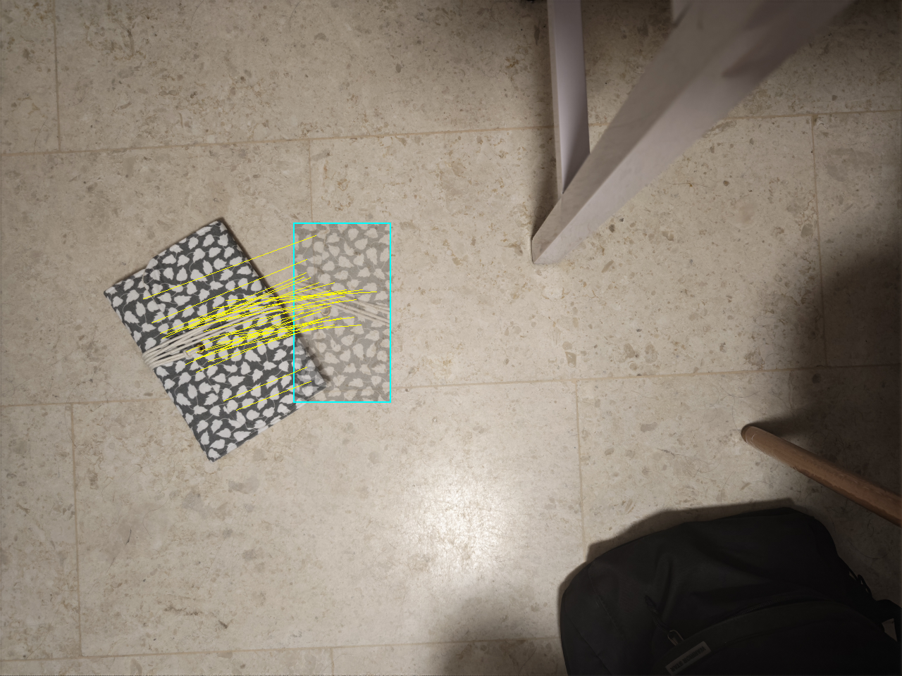
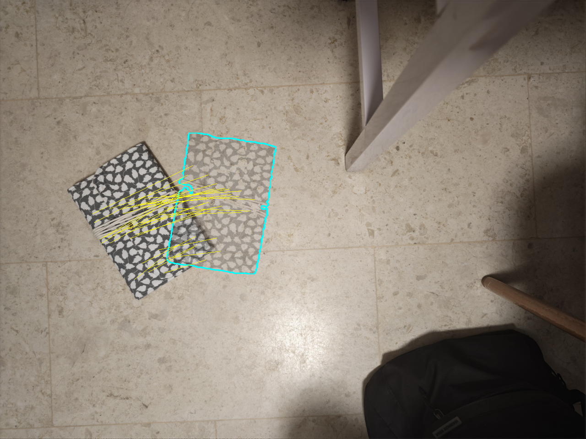
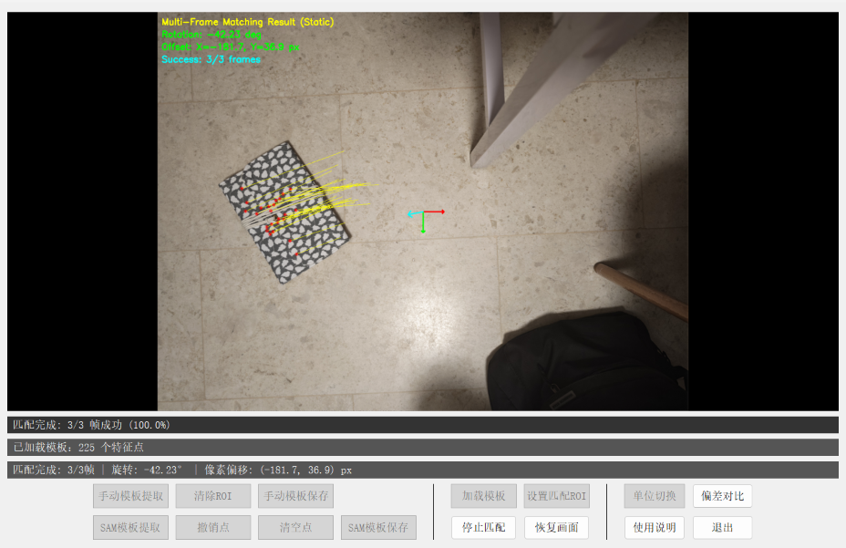

# 2D Part Pose Deviation

使用 RGB 相机拍摄板件，在基准画面中提取 SuperPoint 特征并保存模板；再次拍摄时匹配模板与来料图像，输出平面旋转角和 X/Y 像素偏移。模板既可手动框选 ROI，也可点击前景/背景点，由 SAM 分割目标后提取掩码内特征。可用于固定相机测量平面内物件的位置偏差。

下面两张图用纹理物体代替现场板件，展示同一组基准图与偏移图的离线测试效果。青色轮廓与半透明区域表示模板的原始位置，黄色线段表示通过几何验证的特征点对应关系。

| 手动 ROI 模板 | SAM 点选模板 |
| --- | --- |
|  |  |

下图是图片测试模式下的完整界面：画面定格后显示匹配点、旋转角、像素偏移和多帧成功数。有相机标定文件和高度设置时，可转化为真实尺度。



## 项目结构 📝

```text
2d-part-pose-deviation/
├─ assets/                        # README 使用的实验效果图
│  ├─ roi_comparison.png         
│  ├─ sam_comparison.png          
│  └─ ui_matching_result.png      
├─ configs/                       # 用户配置与 RGB 相机标定数据
│  ├─ config.example.json         # 原项目 RGB 相机参数及应用配置，需修改
│  └─ rgb_calibration.yml         # 原项目 RGB 相机内参和畸变系数，需修改
├─ material_deviation/            # Python 应用包
│  ├─ __init__.py                 # 包初始化
│  ├─ __main__.py                 # 桌面界面入口
│  ├─ settings.py                 # JSON 配置加载与路径解析
│  ├─ camera.py                   # USB RGB 相机采集线程
│  ├─ calibration.py              # 读取相机标定 YAML 并计算像素尺寸
│  ├─ superpoint_model.py         # SuperPoint 网络与推理前端
│  ├─ features.py                 # 特征提取、模板读写与图像匹配
│  ├─ roi.py                      # 可拖拽选区的图像控件
│  ├─ sam_segmentation.py         # SAM 模型加载与点提示分割
│  ├─ sam_workflow.py             # 定格、标点、掩码预览与模板特征提取
│  ├─ comparison.py               # 模板参考图嵌入与半透明偏差叠加
│  ├─ template_workflow.py        # 多帧模板提取、预览、保存与加载
│  ├─ matching_workflow.py        # 多帧匹配、偏差统计与结果显示
│  └─ window.py                   # PyQt5 主窗口与按钮布局
├─ scripts/
│  ├─ calibrate_rgb_camera.py     # 独立命令行相机标定：采图或读图并生成 YAML
│  └─ download_sam_weights.py    # 从官方地址下载可选的 SAM ViT-B 权重
├─ models/
│  └─ superpoint_v1.pth          #  SuperPoint 模型权重
├─ templates/                    # 模板保存目录
│  └─ .gitkeep                 
├─ matching_results/             # 匹配结果 JSON 输出目录
│  └─ .gitkeep                  
├─ .gitignore                     # 排除本机配置、模板和运行结果
├─ pyproject.toml                 # 安装元数据与依赖
├─ requirements.txt              # 运行依赖清单
└─ README.md                     # 使用说明
```

## 相机与配置 🔧

`configs/config.example.json` 已采用原项目的 RGB 相机初始参数，应根据需要修改，重点检查其中的 `camera` 段：

```json
"camera": {
  "video_id": 2,
  "backend": "dshow",
  "width": 2560,
  "height": 1440,
  "fps": 30,
  "exposure": -3,
  "gain": 10
}
```

常改的字段如下：

- `camera.video_id`：OpenCV 相机序号。原设备为 `2`；拔插相机或电脑重启后序号可能变化。若画面打不开，先关闭占用相机的软件，再尝试 `0`、`1`、`2` 等序号。
- `camera.backend`：Windows 默认 `dshow`，也支持 `msmf`、`any`。换后端时仍需确认实际取得的分辨率和曝光控制是否符合预期。
- `camera.width`、`height`、`fps`：请求的采集参数。若更换设备或分辨率，修改后核对启动日志中的实际分辨率；只改 JSON 不保证驱动支持该模式。
- `camera.exposure`、`gain`：原设备值分别为 `-3` 和 `10`。曝光值由相机驱动解释，换相机后应按现场画面重新调整。
- `calibration_file`：相机内参与畸变 YAML，默认 `rgb_calibration.yml`。只有使用**原相机、原镜头和原采集分辨率**时才可沿用；更换设备或分辨率后应重新标定，并把此项改为新 YAML 文件名，没有有效标定时只使用像素偏移。
- `weights_file`：SuperPoint 权重。默认指向本项目 `models/superpoint_v1.pth`；缺少权重时程序会改用 ORB。
- `sam_weights_file`、`sam_model_type`、`sam_device`：可选的 SAM 权重路径、模型类型（默认 `vit_b`）和设备（`auto`、`cpu`、`cuda`）。只有点击“SAM模板提取”时才加载该模型。权重文件需与模型类型对应。
- `comparison_opacity`：点击“偏差对比”后，模板参考图在原位置的透明度，默认 `0.35`，可设为 `(0, 1]`。
- `templates_dir`、`results_dir`：模板 JSON 和匹配结果 JSON 的存储目录。`templates/` 初始为空，不附带现场模板。
- `working_distance_m`：相机光心到被测板件平面的工作距离（米），用于按焦距将像素偏移近似换算为毫米；默认 `1.38` 仅沿用原项目参数，使用前应按现场安装位置实测。
- `template_frames`、`match_frames`：提取模板及计算来料偏差时采集的帧数；`cuda` 控制是否尝试使用 GPU。

### 单目相机的距离换算

使用的 RGB 相机不是深度相机，源码读取标定文件中的焦距 `fx`、`fy`（单位为像素），再用固定的 `working_distance_m` 计算 `X`、`Y` 两个方向的比例：`mm/px = working_distance_m × 1000 / fx`（Y 方向将 `fx` 换成 `fy`）。匹配得到的像素偏移再分别乘以该比例。

现场应让**镜头朝下、光轴近似垂直于水平的板件平面**，并保持模板采集与来料检测时板件位于同一高度。此时 `working_distance_m` 是**相机光心到板件表面的距离**。更换板件高度或调整相机位置后，应重新测量并修改此值。

## 快速运行 🚀

以下命令在 Windows PowerShell 中、从本项目根目录执行。需要可被 OpenCV 读取的 RGB 相机。

```powershell
python -m venv .venv
.\.venv\Scripts\Activate.ps1
python -m pip install -e .
Copy-Item configs/config.example.json configs/config.json
# 按上节检查 configs/config.json 中的相机序号、分辨率与标定文件
python -m material_deviation --config configs/config.json
```

启动后依次操作：

1. 检查相机实时画面。左栏选择模板制作方式：点击“手动模板提取”并拖动框选板件 ROI；或按下文配置 SAM 后点击“SAM模板提取”。
2. 手动框选后点击“手动模板保存”；SAM 点选并确认掩码后点击“SAM模板保存”，程序会提取掩码内特征并保存。生成的 JSON 保存在 `templates/`。
3. 后续启动时点击“加载模板”，选择上述 JSON。需要限制来料搜索范围时点击“设置匹配ROI”。
4. 点击“开始匹配”，程序采集多帧并显示旋转角与像素偏移；结果 JSON 写入 `matching_results/`。“单位切换”可在像素与毫米之间切换，毫米显示需要有效的相机标定。点击“恢复画面”返回实时画面。
5. 点击“偏差对比”可把模板中保存的目标区域半透明叠加在基准位置。匹配结果中的黄色连线继续连接模板点与现场点，方便检查对应关系。再次点击“关闭对比”恢复原画面。

按钮分为左侧模板制作、中间加载与匹配、右侧结果查看三栏，暂时不能执行的按钮呈灰色。模板应在**基准位置**采集，后续偏差都相对于该模板计算。


### SAM 点选模板

SAM 是可选功能。安装依赖后，在项目根目录运行下载脚本；它会从 [Segment Anything 官方列出的 ViT-B 地址](https://github.com/facebookresearch/segment-anything#model-checkpoints)下载权重到默认配置对应的 `models/sam_vit_b_01ec64.pth`。权重不进入 Git；下载脚本使用 Python 标准库，不需要安装额外的下载工具。

```powershell
python -m pip install -e ".[sam]"
python scripts/download_sam_weights.py
```

若下载被网络环境阻断，也可以[直接下载官方 ViT-B 权重](https://dl.fbaipublicfiles.com/segment_anything/sam_vit_b_01ec64.pth)，手动放到上述路径。已有权重位于别处时，在 `configs/config.json` 中修改 `sam_weights_file`；使用其他模型时也要同步修改 `sam_model_type`。下载脚本不会覆盖已有文件，确需重新下载可添加 `--force`。

在界面点击“SAM模板提取”定格当前画面。左键点击板件添加前景点，右键点击背景添加排除点；每次点击都会更新红色半透明掩码和蓝色边界。“撤销点”和“清空点”可调整提示。确认掩码只覆盖目标板件后，点击“SAM模板保存”一次完成 SuperPoint 特征提取与保存。“恢复画面”退出定格状态。SAM 只用于**制作模板**；后续匹配仍使用 SuperPoint。SAM 权重文件较大，未放入仓库。

### 更换相机后的标定

标定脚本 `scripts/calibrate_rgb_camera.py` 是独立的标定文件，只需 NumPy、OpenCV 和 Python 标准库。先连接 RGB 相机，准备棋盘格标定板，并量出每个方格的边长。`--columns` 和 `--rows` 填**内部角点数**，不是方格数；下例的 `9×6`、`20 mm` 仅为示例，请按手中的标定板修改。

在项目根目录运行以下命令，脚本会读取 `configs/config.json` 的相机序号、采集分辨率、曝光等参数并打开预览。画面找到角点时，移动和倾斜棋盘格，按空格保存不同位置、角度的图像，最后按 `q` 或 Esc 结束并直接生成 YAML。建议采集十几张以上覆盖画面不同区域的清晰图像；程序至少需要 3 张有效图像。

```powershell
python scripts/calibrate_rgb_camera.py --config configs/config.json --columns 9 --rows 6 --square-mm 20 --output configs/rgb_calibration.local.yml
```

若已经有棋盘格照片，可不连接相机，直接用图片标定：

```powershell
python scripts/calibrate_rgb_camera.py --images "captures/*.png" --columns 9 --rows 6 --square-mm 20 --output configs/rgb_calibration.local.yml
```

生成的 YAML 含 `K`、`D` 和标定图像尺寸，与 UI 读取的 `rgb_calibration.yml` 格式相同。将 `configs/config.json` 中的 `calibration_file` 改为 `rgb_calibration.local.yml` 后再启动 UI。脚本默认文件名是 `configs/rgb_calibration.yml`，但仓库已经附有原设备的同名文件；为避免覆盖，示例使用 `.local.yml`。如确需覆盖已有文件，显式添加 `--overwrite`。采集和实际匹配应使用相同的相机、镜头与分辨率；`working_distance_m` 是另一个需要现场测量的参数，不由棋盘格内参标定得到。

## 依赖与结果说明

Python 3.10+；核心依赖为 NumPy、OpenCV、PyQt5、PyTorch 和 scikit-learn，版本下限见 `requirements.txt`。SuperPoint 权重来自原项目；在公开上传前应核对该权重的来源与再分发许可。

### 旋转与位移的计算

匹配点经过几何验证后，程序用相似变换同时估计旋转、尺度和平移。对模板中的图像点 `p = (x, y)`，其在来料图像中的对应位置为：

```text
     [ a  -b  tx ] [ x ]
p' = [ b   a  ty ] [ y ]
                     [ 1 ]

旋转角 θ = atan2(b, a) × 180 / π
尺度   s = √(a² + b²)
```

设 `c` 为模板保存的**全部特征点**的平均坐标，则程序显示的像素位移是这个中心变换前后的差值：`d = A · (cₓ, cᵧ, 1)ᵀ − c`。因此 `pixel_offset = (dₓ, dᵧ)`，**不是**矩阵中的 `(tx, ty)`；后者是相对于图像坐标原点的平移项。同一变换也可写成 `p′ = c + d + sR(θ)(p − c)`，便于理解为绕模板中心旋转和缩放，再移动中心。图像坐标的 X 向右、Y 向下，正角在画面上表现为顺时针旋转。多帧匹配成功时，最终旋转角和 X/Y 位移分别取各帧结果的中位数。

输出的 `rotation_deg` 是图像平面中的相对旋转，`pixel_offset` 是模板与现场图像的 X/Y 像素偏差。

## 作者的话
